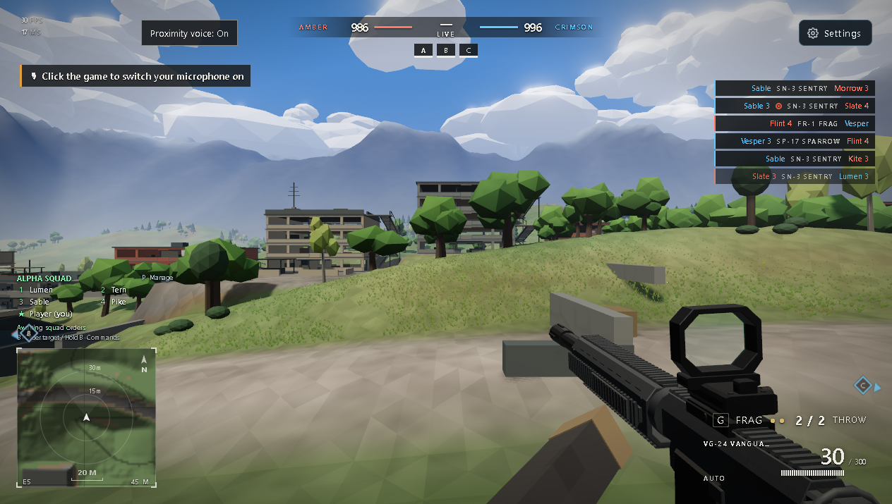

# PATIO — offline mirror

Full mirror of **PATIO** (https://play.patio.fyi/) — "Friends session", a low-poly
multiplayer 8v8 FPS with proximity voice.

Source: https://play.patio.fyi/



## Stack

- **Vite production build** served at the origin root by Cloudflare — a module
  entry (`assets/index-CBqjwezZ.js`) with 161 hashed app/vendor chunks loaded
  through `__vite__mapDeps` tables and dynamic `import()`
- **three.js r185 in a vendor chunk** — `assets/graphics-quality-BsjABS0s.js`
  carries the bundled WebGLRenderer engine (indexed wholeFile, never sliced)
- **session bootstrap** — `session.js` is a plain script tag in the entry
  document whose `data-*` attributes (`data-ruleset="r17-bascule-v1"`,
  `data-lobby="1"`, `data-map-name="Bascule"`, `data-backdrop=…`) wire the URL
  parameters and point the client at the multiplayer backend
  (`wss://<host>/socket`); `__modules.json` at the root is the served chunk map
- **self-hosted assets** — models (GLB/glTF), maps/imagery, voice + movement
  WAVs and the Barlow Condensed webfonts all ship from the same origin

## What this is

PATIO (play.patio.fyi) — "Friends session": a low-poly multiplayer FPS with
proximity voice, played 8v8 over a session code (the capture carries ruleset
`r17-bascule-v1`, map Bascule — a double-tower bridge map). The client is a Vite
production build of a three.js shooter: session bootstrap (`session.js`), a
hashed module entry, a front-desk overlay chunk, a bundled three.js r185 vendor
chunk, and the full runtime graph — 161 JS chunks, one stylesheet, 84 GLB + 25
glTF models, 47 JPG + 10 PNG images, 167 WAVs (voice lines, movement bank), five
webfonts, five JSON manifests and the entry document. Captured whole, byte-exact
under `.upstream/manifest.json`: **506 files, 88,519,981 bytes**. The runtime
graph was driven to a fixpoint by `tools/capture.mjs` (see the derivation note).

Live backend (stays external — not part of the capture): the session bootstrap
points the client at the origin's multiplayer WebSocket (`wss://<host>/socket`);
the page also polls `/health`, the front-desk chunk fetches `/api/battlefield`
for the map assignment (falling back to the captured
`assets/maps/deployment/manifest-v4.json` when unreachable) and `session.js`
POSTs best-effort boot telemetry to `/diag/boot`. A local static serve therefore
boots the UI but reports "Multiplayer server unavailable" — the build has no
solo fallback; multiplayer needs the live host.

## Layout

- `index.html` + `session.js` + `assets/` + `__modules.json` — the capture at the
  origin root (served paths = on-disk paths)
- `.upstream/manifest.json` — sha256 + bytes for every captured file (Gen-A)
- `_mirror-report.json` — crawl record: request count, fetched paths, recorded
  404 gaps, external references
- `readable/` — prettified derived layer (pinned prettier 3.9.6): 161
  `*.pretty.js` + 2 `*.pretty.css` + `index-inline-map.json`
- `src/` + `split-spec.json` — 1,023 statement-aligned slices with the recorded
  derivation spec (1,182 sections)
- `docs/cover.png` — gameplay cover; `docs/boot-2026-10-12.png` — boot evidence
- `tools/capture.mjs` — byte-exact capture + runtime-closure fetch (`--check` for
  a residual closure audit)
- `tools/derive.mjs` — rebuild `readable/` + `src/` + `split-spec.json`
- `tools/verify.mjs` — re-hash the capture against the manifest
- `tools/update.mjs` — read-only drift probe against the live origin
- `tools/audit.js` — integrity gate for the derived layers (`AUDIT PASS`)

## Assets

- **audio** — 167 file(s): `assets/audio/voice/lewis/` (125 WAVs, the lewis voice
  bank), `assets/audio/voice/` (19 WAVs, shared voice lines), 
  `assets/audio/movement/` (23 WAVs — concrete/wood/leaves/snow/dirt footsteps +
  `helicopter-hover-213.wav`), plus `assets/audio/voice/manifest.json`,
  `assets/audio/voice/lewis/manifest.json`, `assets/audio/movement/manifest.json`
- **models** — 109 file(s): `assets/` (71 GLB/glTF — vehicles, weapons,
  characters: `car-*.glb`, `weapon-*.glb`, `cube-soldier`), `assets/props/cars/`
  (11), `assets/props/cityprops/` (24 street props), `assets/props/maha/`,
  `assets/props/original/`
- **images** — 57 file(s): `assets/maps/` (17 — map backdrops, e.g.
  `bascule-v1.jpg`), `assets/maps/deployment/` (30 — deployment-board art),
  `assets/greywater-harbor/` (7 — harbor terrain PNGs), `assets/` (3 —
  `diffuse-CCPvaCze.jpg`, `launcher_diffuse-DKGqmXqV.png`,
  `rocket_diffuse-CON9c9TI.png`)
- **fonts** — 5 file(s): `assets/fonts/barlow-condensed/` (latin 300/400/500/600/700
  `woff2`)
- **data** — 5 JSON file(s): `__modules.json`, `assets/maps/deployment/manifest-v4.json`,
  `assets/audio/voice/manifest.json`, `assets/audio/voice/lewis/manifest.json`,
  `assets/audio/movement/manifest.json`

## Run

Open `index.html` through any static file server (the capture is a static site
served at the origin root; no build step):

```
npx serve .
```

The UI boots from the captured files; multiplayer needs the live host (see
"What this is"). The boot evidence in `docs/boot-2026-10-12.png` was taken
through a local boot harness that answers `/session.js` with an empty 200 (boot
test only — the capture itself is never modified), which lets the same captured
chunks reach the game's in-page offline path; the deploy screen renders with the
full HUD.

## Verify

```
node tools/verify.mjs            # re-hash the capture against the manifest
node tools/audit.js              # derived-layer integrity gate → AUDIT PASS
node tools/capture.mjs --check   # residual closure audit → 0 new unresolved
```

## Updating from upstream

```
node tools/update.mjs            # read-only drift probe: what changed upstream
```

The probe never rewrites the capture — a mirror is a point-in-time snapshot.
The origin serves the entry only at `/` (it 404s `/index.html`), so the probe
falls back to the root form; every captured file is then probed at its served
path and hash-compared (the entry document text-compared after normalizing the
per-response Cloudflare nonce). Refreshing means re-fetching into a clean tree
(`node tools/capture.mjs`), re-cutting the manifest, and re-deriving
`readable/` + `src/` from the new bundle with `node tools/derive.mjs`.

**Drift observed 2026-10-12/13** (after the capture): the origin redeployed —
`node tools/update.mjs` reports `DRIFT: 2 changed` (`index.html`, `session.js`):
ruleset `r17-bascule-v1` → `r17-bascule-v2` (new "Conquest · … tall ship rams
the bridge" blurb) and the entry/front-desk bundle hashes moved
(`assets/index-Cl5VwtoB.js`, `assets/front-desk-BJDJEZTO.js`). The capture
remains the frozen point-in-time snapshot (v1); a refresh would re-cut all
derived layers from the v2 build.

### 2026-10-12/13 capture + readable/src derivation (and resume note)

- **Capture** (byte-exact, nothing edited): 506 files, 88,519,981 bytes — entry
  `index.html` (2,370 B), `session.js` (41,969 B), 161 JS chunks (largest:
  `assets/graphics-quality-BsjABS0s.js` 752,305 B — the three.js r185 vendor
  bundle), the stylesheet `assets/ui-B08v0AKp.css` (100,790 B), models, maps,
  imagery, voice + movement audio, fonts and the JSON manifests. Closure was
  driven to a fixpoint by `tools/capture.mjs`: static HTML refs, import
  specifiers, `new URL(…)`, `__vite__mapDeps`-style chunk tables, asset-path
  literals, and the runtime-instantiated template targets the literal scanner
  cannot see. Final closure audit: `1239 reference group(s), 58 unresolved
  (0 new vs _mirror-report.json), 0 external off-origin reference(s)` — every
  unresolved reference is a probed-and-recorded 404 gap (e.g. the shipped raw
  sim chunk's dev-only sibling imports, and Freesound provenance filenames
  inside the movement manifest that upstream does not serve).
- **Resume note (2026-10-12/13)** — a fleet-wide network outage killed the
  first capture agent mid-onboarding; this pass re-verified all in-tree work
  before trusting it: `node tools/verify.mjs` → `506 files checked, 0
  problems`, closure scan → 0 new unresolved, and a fresh opencli play test of
  the locally served mirror (190 requests) showed 0 failed requests with every
  same-origin path present in the manifest. Three real defects were found and
  fixed: (1) the movement audio bank (`assets/audio/movement/` — manifest + 23
  WAVs) was missing from the capture because the runtime builds the URL as
  `U + "manifest.json"` with `U = "/assets/audio/movement/"`; the bank was
  fetched from the origin into the capture and every WAV sha256 was verified
  against the hash the site's own manifest declares; (2) `tools/update.mjs`
  exited on the documented `/index.html` 404 before its root-form fallback ran
  — the fallback now works and the probe reports the v2 drift above; (3) the
  audit's pretty→capture completeness rule flagged the inline-twin
  `readable/index-inline-1.pretty.css` (an inline `<style>` twin has no capture
  `.js`/`.css` of its own). The rule was fixed the dead-world/unburied way —
  map-recorded inline twins are exempted from the capture-mapping loop while
  the inline-block validation got *stronger*: twin must exist, not be
  byte-identical to its block (prettier did run), be referenced by
  split-spec.json, match the map's byte range + sha256 against the capture
  bytes, and re-render byte-exact from the capture byte range under the pinned
  prettier. `node tools/audit.js` now prints AUDIT PASS with
  `1 inline content block(s) with twins + index-inline-map.json`.
- **readable/** — pinned prettier 3.9.6 (module API, default options, formatted
  to a layout fixed point, 1–2 passes — never the CLI, it respects `.gitignore`
  and can silently echo its input) rendered 161 JS chunks to
  `readable/<name>.pretty.js` (nested dirs flattened with `__`; largest:
  `assets__yard-dressing-view-Du2F6MWT.pretty.js`, 17,563 lines) and the
  stylesheet to `readable/assets__ui-B08v0AKp.pretty.css` (5,083 lines). Every
  pretty is provably not a byte copy of its capture source and re-renders
  byte-exact under the pinned version.
- **Inline blocks** — the entry document carries one inline `<style>` block
  (the rotate-hint/UI CSS at bytes 829–1907 of `index.html`); it gets the
  wholeFile twin `readable/index-inline-1.pretty.css` plus
  `readable/index-inline-map.json` recording the exact byte range + sha256.
  The two external `<script>` tags (session bootstrap + module entry) are not
  derived.
- **src/** — 1,023 statement-aligned slices (`src/<tag>-NN.js`, exact 2-line
  provenance header) recorded in `split-spec.json` (1,182 sections): 1,023/1,023
  parse standalone (`node --input-type=module --check -`) and round-trip
  byte-exact to their readable line ranges. Cuts land only on top-level
  declaration boundaries (~250–350 line windows); oversized single declarations
  stay whole.
- **Vendor rule — wholeFile sections, never sliced**:
  `assets/graphics-quality-BsjABS0s.js` is the bundled three.js r185 graphics
  engine (WebGLRenderer + `__THREE__` revision registration), content-anchored
  and guarded. Stylesheet rule: `assets/ui-B08v0AKp.css` is wholeFile.
  Non-standalone parts are skipped sections, indexed but never sliced (156
  skipped — every app chunk's final `export {…}` table).
- **notRendered** — 338 hashed payload records in `split-spec.json` (167 audio,
  109 models, 57 images, 5 fonts; bytes + sha256, no pretty pass).
- **Gates**: `node tools/verify.mjs` → `506 files checked, 0 problems`;
  `node tools/audit.js` → `AUDIT PASS` (1,023/1,023 round-trips, 163/163
  pretties re-render byte-exact, 1,182 sections, 1 inline block with twin);
  `node tools/capture.mjs --check` → `0 new unresolved`; independent 3-slice
  round-trip check → 3/3 byte-exact. Boot test: mirror served on loopback
  through the boot harness, opened through opencli — the deploy screen
  rendered (`docs/boot-2026-10-12.png`), and the cover shows live gameplay
  (FPS view, VG-24 VANGUARD, ALPHA SQUAD roster, AMBER/CRIMSON score). Serve
  probe: `npx serve .` on loopback, entry + 3 hashed assets + `session.js` over
  HTTP 200 at their recorded sizes, listener PID killed, port proven closed
  (`netstat`).
- **§0.4 fork-over-mirror checked 2026-10-12/13**: no public upstream source
  repo exists — the capture contains zero `github.com`/`gitlab.com`/`bitbucket`
  references (the only off-origin URLs in captured text are the w3.org SVG
  namespaces and a jcgt.org shader citation, plus freesound.org/
  creativecommons.org provenance links inside the movement manifest), so the
  mirror stands.
- **Open task (PLAN §5)**: identifiers in `src/` are the bundle's own minified
  names; the deep identifier-rename campaign is not yet done. Rebuild the
  derived layers any time with `node tools/derive.mjs`.

## Mirror conventions

- **Capture layer** — the captured files are byte-exact copies of what the
  origin served; nothing in them is edited. `.gitattributes` pins `* -text` so
  git never normalizes EOLs.
- **Vendor integrity** — three.js and every model/audio/font stay byte-exact as
  served; `readable/` never rewrites vendor bytes (vendor regions are indexed
  whole, never sliced).
- **Readable layer** — `readable/` is derived (prettified) and never shipped to
  a browser; it exists so the bundle can actually be read.
- **Provenance** — `.upstream/manifest.json` records sha256 for each captured
  artifact, and `tools/verify.mjs` re-checks it; `_mirror-report.json` is the
  crawl record.
- **Drift** — `tools/update.mjs` is read-only: it reports what changed upstream
  and never rewrites the capture.

## Fleet status

<!-- mirror-status:start — feeds _standard/REPO-INDEX.md. Update ONLY your own mirror's block; never edit the shared index (PLAN §8). Rebuild: node _standard/build-index.mjs -->
<!-- cols: cls=classification · ver=verify 0 problems · upd=drift probe · man=manifest · rdbl=readable re-derived · src=reversed src · boot=boot test · top=offline-mirror topic · tag=backup tag · staged=staged not committed -->
| # | repo | cls | ver | upd | man | rdbl | src | boot | top | tag | staged |
|---|---|---|---|---|---|---|---|---|---|---|---|
| 293 | patio-fyi | mirror | ✓ | ✓ | ✓ | ✓ | ✓ | ✓ | ✓ | — | — |
<!-- mirror-status:end -->
